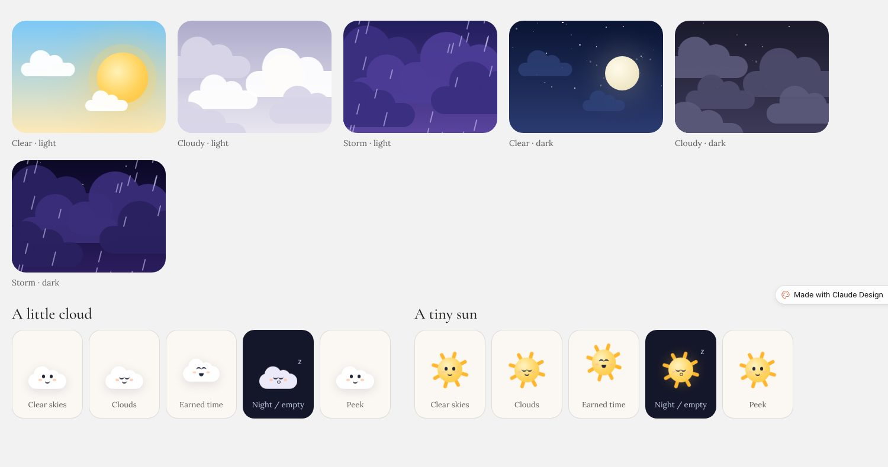

# Toll design guidelines

**Every screen is built to match the approved design.** If your screen looks different from its reference image below, the design wins; change the screen, not the design.

- **Approved design (live, every screen and state, light and dark):** https://claude.ai/artifact/6W9BYCvTubVmr9SMrv143m
- **Reference images in this repo:** [`docs/design/`](design/), one per state, named by the design's own numbering (`1-3-storm.jpg` is state 1.3).
- **Product rules** (what each screen must do) stay in the planning doc: https://claude.ai/artifact/A3B1LtX6YVTR43D3Uao8br

## The idea in one line

**Your phone has weather.** Toll sets the sky through your day. Internally the strictness levels are `open`, `metered` and `sealed`; users only ever see **Clear skies**, **Cloudy** and **Storm**, and earned minutes are **umbrella time**.



## Which screen is whose

Build your screens from the reference image. "Code" is where the screen lives.

| Design | Screen | Owner · task | Code |
| --- | --- | --- | --- |
| 0 | Sky scene and mascot | A · A12 | `src/ui/SkyScene.tsx`, `src/ui/Mascot.tsx` |
| 1.1 – 1.8 | Storm / Cloud screen, all states | A · A6 | `src/device/screens/StormView.tsx` |
| 2.1 – 2.5 | Today | B · B9 | `src/day/screens/TodayScreen.tsx` |
| 3.1 – 3.9 | Quest sheet (offer, progress, pass, miss, meetup) | B · B8 | `src/day/screens/QuestSheetHost.tsx` |
| 4.1 – 4.2 | Plan my day (optional) | B · B2 | `src/day/screens/PlanMyDaySheet.tsx` |
| 5.1 – 5.4 | Forecast: week, month, 6 months, empty | A · A11, A13 | `src/device/screens/ForecastView.tsx` |
| 6.1, 6.2, 6.4 | Onboarding: weather, permissions, apps and sleep | A · A7 | `src/device/screens/OnboardingView.tsx` |
| 6.3 | Onboarding: set home | B · B1 | `src/day/components/SetHomeStep.tsx` |
| 7.1 | Settings | C · C7 (hosts A's apps section and B's planner section) | `src/engine/screens/SettingsContainer.tsx` |
| 7.2 | Timetable editor | B · B1 | `src/day/components/PlannerSection.tsx` |
| 7.3 | Weather thresholds | C · C7 | `src/engine/screens/EngineSection.tsx` |
| 7.4 | ~~Supermemory opt-in~~ | **dropped, do not build** | none |
| 8.1 | Notification shade | A · A10 | `src/device/notifications.ts` (copy) |

## How to build a screen the design's way

Everything shared lives in `src/ui/` (owned by A; import it, do not copy it).

```tsx
import { useTheme, useSky, WeatherChip, Button, BalanceNumeral } from '../../ui/components';
import { SkyScene } from '../../ui/SkyScene';
import { Mascot } from '../../ui/Mascot';
import { Icon } from '../../ui/Icon';
import { Card, Display, Body, Segmented } from '../../ui/primitives';
import { fonts } from '../../ui/theme';

// A screen over the sky: the sky fills the screen, content sits on top.
<View style={{ flex: 1 }}>
  <SkyScene posture={state.posture} quiet />
  <Text style={{ fontFamily: fonts.display, fontSize: 68 }}>{weatherName}</Text>
</View>
```

- **Always read colours through `useTheme()` / `useSky(posture)`**, never hex values in a screen, so light and dark both work.
- **Never write the words "posture", "open", "metered" or "sealed" on screen.** Map them through `src/ui/weather.ts`.
- **Preview your screen without a phone** and compare it with its reference image: see [Preview](#preview-without-a-phone).

## Colour

Light and dark are both first class (dark is a "starry night"). No red anywhere: **Storm is indigo and violet**. Gold means "umbrella time" and nothing else.

| Token | Light | Dark | Used for |
| --- | --- | --- | --- |
| `bg` | `#fbf8f3` | `#0e1120` | screen background |
| `card` | `#ffffff` | `#171b2e` | cards, rows |
| `surface` | `#f3efe6` | `#1f2438` | segmented switcher, chips |
| `text` / `muted` / `faint` | `#1d2130` / `#565b6c` / `#8a8e9c` | `#eef0f8` / `#a9aec4` / `#7c8199` | text |
| `gold` | `#c28d41` | `#e1ad66` | umbrella time, selected |
| `goldText` | `#7d5411` | `#facb8d` | gold text |
| `primaryBg` / `primaryText` | `#ffe3bf` / `#3a270d` | same | the peach primary button |
| `free` | `#4f9ad6` | `#7cb8ea` | free-time meter |
| `good` | `#2f7d6b` | `#6fcfb5` | "On", ticks |
| `storm` / `stormTint` | `#4b3a8f` / `#ece9f8` | `#a99af0` / `rgba(169,154,240,.14)` | storm accents |

The sky behind weather screens has its own table (gradient top and bottom, text colours, translucent chip and button fills) in `src/ui/theme.ts` (`SKY`). Do not re-derive it.

## Type

| Use | Font | Size |
| --- | --- | --- |
| The weather word ("Storm") | Cormorant Garamond 500 | 68 / line 65 |
| Screen titles ("Forecast") | Cormorant Garamond 500 | 40 |
| Big numbers (umbrella time) | Cormorant Garamond 600 | 40 to 48 |
| Reason, headlines | Roboto 500 | 20 to 21 |
| Body | Roboto 400 | **16 minimum** |
| Secondary text | Roboto 400 | 14 |

Fonts load once in `src/ui/FontGate.tsx`. Use the names in `fonts` (`src/ui/theme.ts`).

## Shape and spacing

Cards 22 radius with a hairline border. "Doors" (the stacked choices) 20. Buttons 16, 52 to 56 high. Chips are pills. **Touch targets are at least 44.** Screens use 16 to 22 side padding and 10 to 14 gaps.

## Icons

Lucide, 2px stroke, always in a text colour from the theme. Add a new one in `src/ui/Icon.tsx` (it only imports the icons the design uses). Weather icons: sun (moon at night, Clear only), cloud, cloud-lightning. Umbrella time is the umbrella icon.

## The mascot

A small white cloud, or a tiny sun, with a face. Default is the cloud; `variant="sun"` is the alternative.

| Mood | Where it appears |
| --- | --- |
| `happy` | Clear skies: Today, onboarding step 1 |
| `calm` | Cloudy |
| `celebrate` | earned time: a passed quest (it hops) |
| `sleepy` | night, or nothing to show yet: the empty Forecast |
| `peek` | a quick hello next to a title |

Rules: it reacts to the weather and celebrates earned time. It **never scolds, begs or guilt-trips**, and it **stays off the Storm screen**. It always respects reduce-motion.

## Motion

Drifting clouds, rain and a rare lightning flash in a Storm, twinkling stars at night, a slow bob on the mascot, and an umbrella that opens when time is spent. The Storm settles while the user waits 60 seconds ("calm"). **Everything animated goes through `src/ui/motion.ts`, which turns it off when the phone's reduce-motion setting is on.**

## Words

Calm, specific and kind. Copy comes from the design; do not reword it. **Never use "blocked", "failed" or "posture"** in anything a user reads, and never shame ("Welcome back", never "you failed again"). No levels, ranks, badges, streak flames or collectibles: the app must not become the new compulsion.

## Where we differ from the design, on purpose

- **No Supermemory opt-in screen (7.4).** Supermemory was dropped from the project.
- **"Wait 60 seconds" ends on "That's a minute"** and lets the user choose (close the app or take a quest), as in the design. It does not close the screen by itself.

## Preview without a phone

```bash
npm install
npm run web            # dev server with hot reload; open the URL it prints
npm run preview:web    # or: export once, then serve at http://localhost:4173
```

The state gallery (Person A's `/gallery` page, every A screen and state in light and dark) arrives with Spec A. To photograph it: `npm run preview:web`, then `node scripts/screenshots.cjs` (needs `npm i -D playwright && npx playwright install chromium`).
